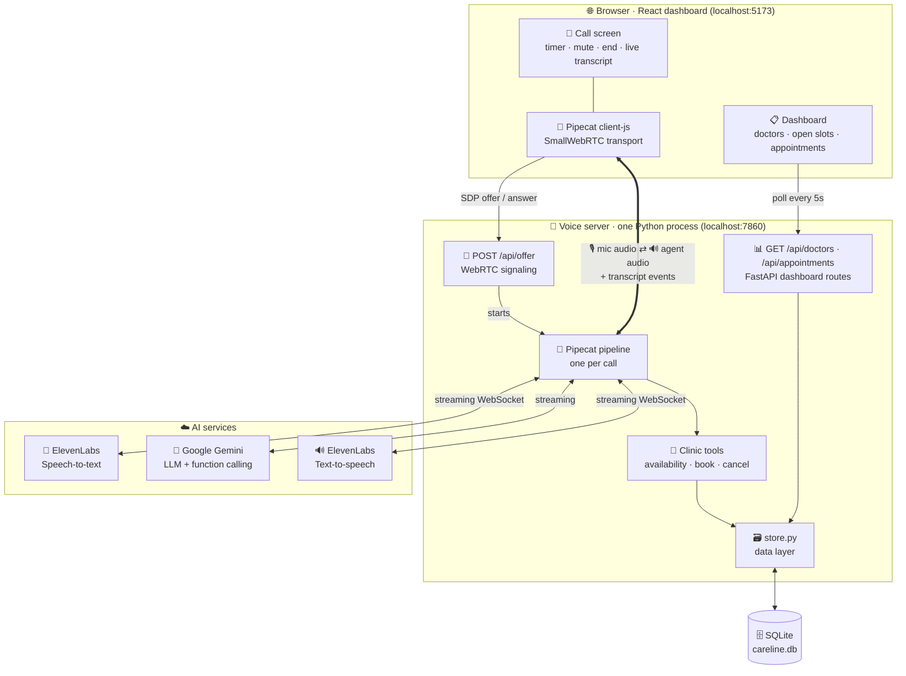
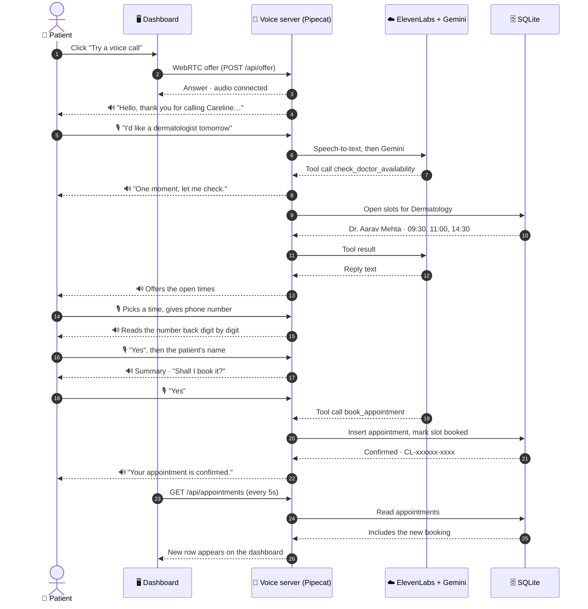
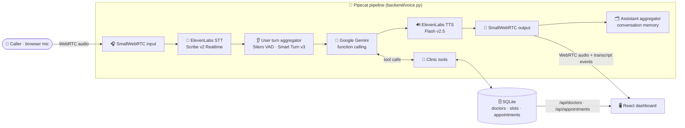

<div align="center">

<br/>

```
 ██████╗ █████╗ ██████╗ ███████╗██╗     ██╗███╗   ██╗███████╗
██╔════╝██╔══██╗██╔══██╗██╔════╝██║     ██║████╗  ██║██╔════╝
██║     ███████║██████╔╝█████╗  ██║     ██║██╔██╗ ██║█████╗
██║     ██╔══██║██╔══██╗██╔══╝  ██║     ██║██║╚██╗██║██╔══╝
╚██████╗██║  ██║██║  ██║███████╗███████╗██║██║ ╚████║███████╗
 ╚═════╝╚═╝  ╚═╝╚═╝  ╚═╝╚══════╝╚══════╝╚═╝╚═╝  ╚═══╝╚══════╝
```

**Book a doctor by just talking.**

<br/>

[](https://www.python.org/)
[](https://github.com/pipecat-ai/pipecat)
[](https://elevenlabs.io/)
[](https://ai.google.dev/)
[](https://react.dev/)
[](https://www.sqlite.org/)

<br/>

[](https://github.com/Void-Anvesha/NexVoAI)

<br/>

</div>

---

## 📞 What is Careline?

**Careline** is a **real-time voice AI receptionist** for a doctor's clinic. A patient starts a call from the browser and simply talks: the agent checks a doctor's availability, books an appointment and cancels one, all in one natural conversation. A live dashboard shows the transcript, the doctors and their open slots, and the appointment list updating as the agent books or cancels.

The caller is identified **only by what they say on the call**: their phone number (read back digit by digit for confirmation) and the patient's name. No login, no OTP, no caller ID.

---

## 🚨 Problem Statement

Clinics still run appointment booking over the phone, and the phone line is a bottleneck.

| Pain Point | Reality |
|---|---|
| ☎️ **Busy lines** | Patients wait on hold or give up during peak hours |
| 🕘 **Office hours only** | Nobody answers the phone after the front desk closes |
| 🔁 **Repetitive work** | Staff spend their day answering the same "is the doctor free on…?" question |
| 📝 **Manual errors** | Numbers and names are misheard or mistyped into the register |

> **Careline answers every call instantly, books straight into the schedule, and confirms every detail out loud.**

---

## 💡 Solution Overview

A **Pipecat** voice pipeline streams the caller's audio from the browser over WebRTC, transcribes it with **ElevenLabs**, lets **Google Gemini** decide what to do (including calling clinic tools), and speaks the answer back with **ElevenLabs** text-to-speech, all in real time.

Gemini doesn't guess: availability, bookings and cancellations go through three **function-calling tools** that read and write a SQLite database. The same database feeds the dashboard, so a booking made by voice shows up on screen within seconds.

---

## 🏛️ System Architecture



| Component | Where | Responsibility |
|---|---|---|
| **Dashboard** | `frontend/src/main.jsx` | Starts and ends calls, plays the agent's audio, shows the live transcript, lists doctors, slots and appointments |
| **Voice server** | `backend/voice.py` | Accepts WebRTC calls, runs one Pipecat pipeline per call, and also serves the dashboard API |
| **Dashboard API** | `backend/main.py` | Read-only routes the dashboard polls (`/api/doctors`, `/api/appointments`, `/api/availability`, `/api/health`) |
| **Data layer** | `backend/store.py` | Seeds demo data, fuzzy doctor matching, booking and cancellation in SQLite |
| **Speech formatting** | `backend/speech.py` | Turns times, dates and phone numbers into words before they're spoken |
| **AI services** | ElevenLabs, Google | Speech-to-text, the LLM and text-to-speech; the only things that leave the machine |

### 🔄 Request flow: one booking



---

## 🧰 Agent Tools (Function Calling)

| Tool | What it does |
|---|---|
| 🔍 **`check_doctor_availability`** | Returns open slots for a doctor or specialty, optionally for a date. Understands everyday phrasing ("dermatologist", "skin doctor", "Dr. Mehta", "knee pain"). If the requested day is full, it returns the next open days instead. |
| 📅 **`book_appointment`** | Books a slot for the caller's confirmed phone number **and** patient name. Refuses to book without a name or for a slot that's already taken. |
| ❌ **`cancel_appointment`** | Finds the caller's active appointment by phone number; the patient name picks the right one when family members share a number. If it's still ambiguous, it asks which appointment to cancel. |

---

## 🏗️ Voice Pipeline (inside Pipecat)



**One turn, step by step:**
1. The browser streams microphone audio to the Pipecat server over WebRTC.
2. **ElevenLabs Scribe** transcribes it in real time.
3. **Silero VAD** detects speech and the **Smart Turn v3** model decides when the caller has actually finished, so pauses while reading out a phone number don't cut them off.
4. **Gemini** answers, or calls a clinic tool and then answers with the result.
5. Times, dates and phone numbers are rewritten into speakable words ("11:00" → "eleven AM", "2026-11-26" → "Thursday, November twenty-sixth", "9876543210" → "9 8 7 6 5, 4 3 2 1 0").
6. **ElevenLabs TTS** speaks the reply, which streams back to the browser; the transcript appears in the call screen.

---

## ✨ Key Features

| Feature | Description |
|---|---|
| 🎙️ **Real-time voice calls** | Talk to the agent from the browser; no phone line or app needed |
| 🔐 **Spoken identity** | Phone number read back digit by digit, then the patient's name, before any booking or cancellation |
| 🧠 **Natural turn-taking** | Smart Turn v3 waits for the caller to finish; while the agent is talking, only 3+ real words interrupt it, so echo, coughs or "mm-hm" don't cut it off |
| ⚡ **Fast first words** | A fixed greeting plays about 2 seconds after the call connects; a holding phrase ("One moment, let me check") covers tool calls |
| 🛟 **Resilient to LLM stalls** | If Gemini stalls, the request is retried after 3 seconds, and on a longer stall the agent says "Sorry, just a moment" and tries again instead of going silent |
| 🗣️ **Speakable output** | Times, dates and phone numbers are converted to words before text-to-speech |
| 📋 **Live dashboard** | Doctors with open slots, and an appointment list (patient, doctor, date, time, status) refreshed every 5 seconds |
| 💬 **Live transcript** | The conversation appears in the call window as it happens |
| 📱 **Call screen** | Connection state, call timer, mute and end-call buttons |
| 🔇 **Silero VAD** | Voice activity detection inside the Pipecat pipeline |

---

## 🛠️ Tech Stack

| Layer | Technology | Purpose |
|---|---|---|
| **Voice framework** | [Pipecat](https://github.com/pipecat-ai/pipecat) 1.17 (Python) | Real-time pipeline, turn-taking, function calling, WebRTC transport |
| **Speech-to-text** | [ElevenLabs](https://elevenlabs.io/) `scribe_v2_realtime` | Streaming transcription, pinned to English |
| **LLM** | [Google Gemini](https://ai.google.dev/) `gemini-3.5-flash-lite` (configurable) | Conversation and tool calls; chosen for its free tier and low latency |
| **Text-to-speech** | [ElevenLabs](https://elevenlabs.io/) `eleven_flash_v2_5` | Low-latency streaming voice |
| **Turn detection** | Silero VAD + Pipecat Smart Turn v3 | Detects speech and the end of the caller's turn |
| **Transport** | Pipecat SmallWebRTC | Browser ↔ server audio, no third-party room service |
| **Backend API** | [FastAPI](https://fastapi.tiangolo.com/) | `/api/doctors`, `/api/appointments`, `/api/availability`, served by the voice server |
| **Database** | SQLite | Mock doctors, specialties, slots and appointments |
| **Frontend** | React 18 + Vite, `@pipecat-ai/client-js`, `lucide-react` | Dashboard and call screen |

---

## ⚡ Installation & Setup

### Prerequisites

- Python **3.11+**
- Node.js **20+**
- A **Google AI Studio** API key (Gemini, free tier) and an **ElevenLabs** API key
- A microphone and Chrome or Edge

### 1. Clone the Repository

```bash
git clone https://github.com/Void-Anvesha/NexVoAI.git
cd NexVoAI
```

### 2. Create a Virtual Environment

```bash
python -m venv venv

# macOS / Linux
source venv/bin/activate

# Windows
venv\Scripts\activate
```

### 3. Install Dependencies

```bash
pip install -r requirements.txt
cd frontend && npm install && cd ..
```

### 4. Configure Environment

```bash
cp .env.example .env
```

Then fill in `.env`:

| Variable | Required | Description |
|---|---|---|
| `GOOGLE_API_KEY` | ✅ | Gemini API key from [Google AI Studio](https://aistudio.google.com/apikey) |
| `ELEVENLABS_API_KEY` | ✅ | ElevenLabs API key (needs speech-to-text and text-to-speech access) |
| `GOOGLE_MODEL` | | Gemini model, default `gemini-3.5-flash-lite` |
| `ELEVENLABS_VOICE_ID` | | Voice for the agent, default `JBFqnCBsd6RMkjVDRZzb` |
| `DATABASE_PATH` | | SQLite file, default `./careline.db` (created and seeded automatically) |

> 🔒 `.env` is git-ignored. Never commit API keys.

---

## ▶️ How to Run

```bash
python run.py
```

This starts both parts and stops them together on **Ctrl+C**:

| Service | URL | What it is |
|---|---|---|
| Voice server | `http://localhost:7860` | Pipecat voice agent; also serves the dashboard API under `/api` |
| Dashboard | `http://localhost:5173` | React app |

Wait until the voice server prints `Uvicorn running on http://localhost:7860`, open **http://localhost:5173**, click **Try a voice call** and allow microphone access.

<details>
<summary>Run the two parts separately</summary>

```bash
# terminal 1: voice agent + dashboard API
python -m backend.voice -t webrtc --port 7860

# terminal 2: dashboard
cd frontend
npm run dev
```

A standalone API is also available with `uvicorn backend.main:app --port 8000` (set `VITE_API_URL=http://localhost:8000` for the frontend).
</details>

---

## 💬 Example Conversation

```
🤖  Hello, thank you for calling Careline. How can I help you today?
🧑  I'd like to see a dermatologist tomorrow.
🤖  One moment, let me check.
🤖  Dr. Aarav Mehta has nine thirty AM, eleven AM and two thirty PM open
    tomorrow. Which works for you?
🧑  Eleven, please.
🤖  Sure. What's your phone number?
🧑  98765 43210.
🤖  That's 9 8 7 6 5, 4 3 2 1 0, is that correct?
🧑  Yes.
🤖  And the patient's full name?
🧑  Anvesha Rastogi.
🤖  So that's Anvesha Rastogi with Dr. Aarav Mehta, Thursday the
    twenty-sixth at eleven AM. Shall I book it?
🧑  Yes.
🤖  Booking that for you now. Your appointment is confirmed.
```

The booking appears in the dashboard's **Appointments** list, and the slot disappears from Dr. Mehta's availability.

**Seeded clinic data:** 4 doctors (Cardiology · Dermatology · General medicine · Orthopedics), each with 4 slots a day (09:30, 11:00, 14:30, 16:00) for the next 5 days.

---

## 📁 Project Structure

```
NexVoAI/
│
├── backend/
│   ├── voice.py        # Pipecat pipeline: STT → LLM (+ tools) → TTS, turn-taking, greeting, stall recovery
│   ├── store.py        # SQLite data layer: seed data, availability search, book, cancel
│   ├── speech.py       # Rewrites times, dates and phone numbers into words before TTS
│   └── main.py         # FastAPI routes for the dashboard (served by the voice server)
├── frontend/
│   ├── index.html
│   ├── package.json
│   └── src/
│       ├── main.jsx    # Dashboard, call screen, Pipecat client (WebRTC, transcript events)
│       └── style.css
├── run.py              # Starts the voice server and the dashboard together
├── requirements.txt
├── .env.example
├── .gitignore
└── README.md
```

---

## 🧪 Pipeline Description

> Browser microphone audio travels over WebRTC (Pipecat SmallWebRTC) into a Pipecat pipeline. ElevenLabs Scribe transcribes it in real time; Silero VAD and the Smart Turn model decide when the caller has finished speaking. Google Gemini (`gemini-3.5-flash-lite`) gets the turn and either replies or calls one of three tools (`check_doctor_availability`, `book_appointment`, `cancel_appointment`) that read and write a SQLite database. The reply has its times, dates and phone numbers converted to words and is spoken by ElevenLabs TTS back over WebRTC. The agent confirms the caller's phone number digit by digit and asks for the patient's name before booking or cancelling. The React dashboard shows the live transcript from Pipecat's client events and polls the same database for doctors, slots and appointments.

---

## ⚠️ Known Limitations

- **Gemini free tier:** a daily request limit applies per model, and requests occasionally stall. The agent retries and covers the wait, but responses can sometimes take a few seconds. Switch models with `GOOGLE_MODEL`.
- **Speaker echo:** on laptop speakers the agent can occasionally hear itself; headphones give the cleanest calls.
- **Demo data only:** all doctors and patients are fictional; this is not built for real patient information.

---

## 🚀 Future Roadmap

- [ ] ☎️ **Real phone numbers**: Twilio / SIP dial-in through Pipecat's telephony transports
- [ ] 🌐 **Multilingual calls**: Hindi and other regional languages
- [ ] 🔔 **Reminders**: SMS or WhatsApp confirmation after booking
- [ ] 🔄 **Rescheduling**: move an appointment in one step instead of cancel + book
- [ ] 📡 **Push updates**: replace dashboard polling with server-sent events
- [ ] 🗓️ **Real calendars**: sync doctors' schedules with Google Calendar
- [ ] 🐳 **Docker setup**: one-command deployment

---

<div align="center">

<br/>

**Every call answered. Every appointment confirmed.**

<br/>

[](https://github.com/Void-Anvesha/NexVoAI)

<br/>

*If Careline was useful, give it a ⭐ on GitHub.*

</div>
